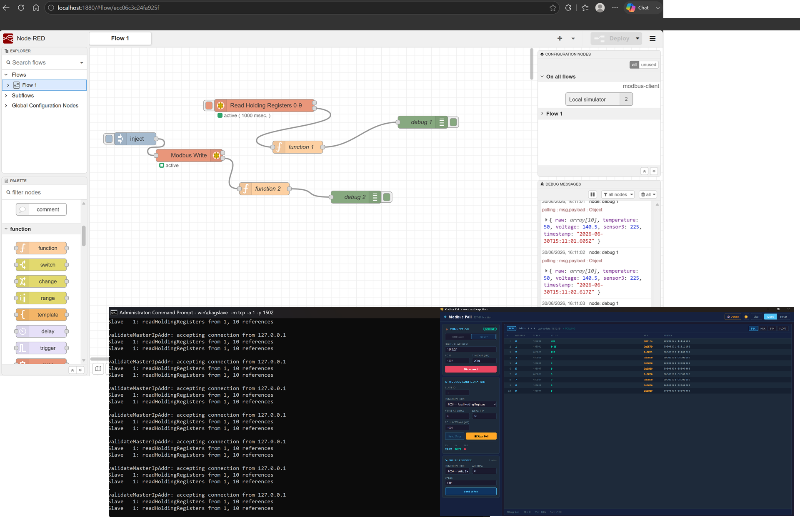
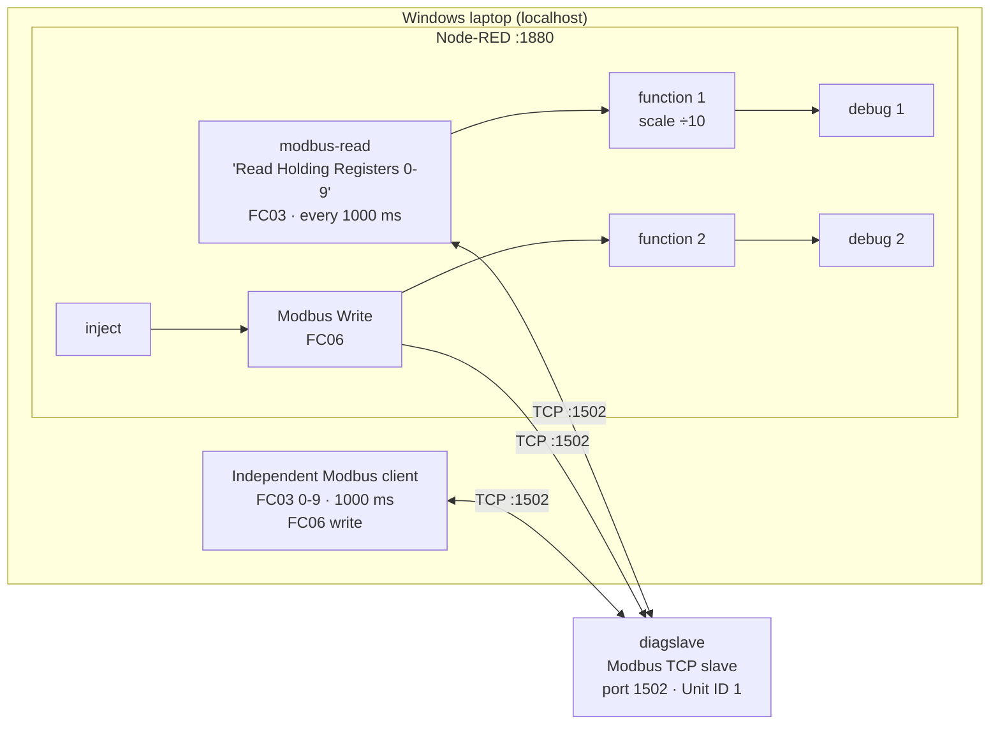
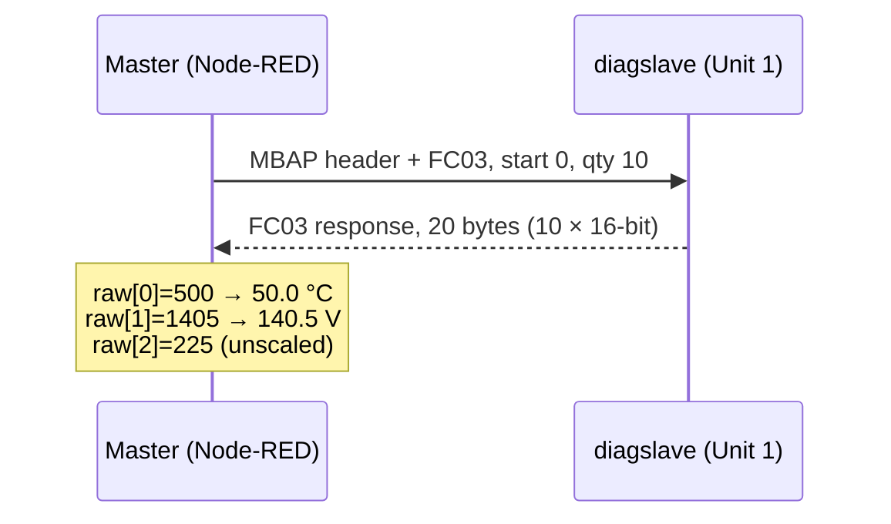
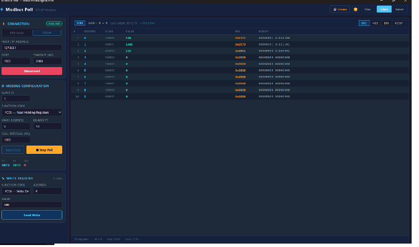

# Modbus TCP Data Collector

**Hands-on Modbus TCP master/slave lab: Node-RED polling and writing holding registers on a diagslave simulator, scaled into engineering units, and cross-checked with an independent Modbus client.**

[](https://www.youtube.com/channel/UC5Cupmz7vlfcodpCX7k8iuQ)
[](https://github.com/the-control-cabinet)


> **The short version:** I built a Modbus TCP client in Node-RED that polls ten holding registers every second from a diagslave simulator, scales the raw integers into engineering units and supports on-demand writes. A second, independent Modbus client polled the same slave alongside it. Its counters reached **2,072 requests, 2,072 responses, 0 errors**, and a value written from that client (FC06, register 0 = 500) appeared in Node-RED as **50.0** after scaling. The usual field faults (timeouts, Unit ID mismatch, port choice, simulator not listening) were hit and resolved along the way.



**Portfolio position:** Stage 1, Protocol Foundations · Field level. Related projects: [BACnet/IP Network Explorer](https://github.com/the-control-cabinet/bacnet-ip-network-explorer) · [Mains Water Metering (Modbus RTU)](https://github.com/the-control-cabinet/mains-water-metering-modbus-rtu)

---

## Contents

1. [Objective](#1-objective)
2. [Scope](#2-scope)
3. [Deliverables](#3-deliverables)
4. [System architecture](#4-system-architecture)
5. [Results at a glance](#5-results-at-a-glance)
6. [Points list](#6-points-list)
7. [Issues dealt with](#7-issues-dealt-with-summary)
8. [Testing](#8-testing-summary)
9. [Outputs](#9-outputs)
10. [Benefits](#10-benefits)
11. [Video](#11-video)
12. [Quick start](#12-quick-start)
13. [Repository map](#13-repository-map)
14. [Roadmap](#14-roadmap)
15. [Skills demonstrated](#15-skills-demonstrated-bms--building-automation)
16. [Disclaimer and licence](#16-disclaimer-and-licence)

---

## 1. Objective

Build practical, transferable experience with **Modbus TCP**, the protocol behind most energy meters, plant-room controllers, VSDs and gateways a BMS engineer integrates.

Specific goals:

- Understand the client/server (master/slave) model, the **Unit ID**, function codes (**FC03** read holding registers, **FC06/FC16** write) and holding-register addressing, including 0-based vs 4xxxx numbering.
- Build a Node-RED flow that both **polls** and **writes** registers.
- Turn raw 16-bit integers into **engineering units** using documented scaling.
- Prove the data path with a **second, independent client** on the same slave.
- Fault-find real communication failures methodically and record the lessons.

## 2. Scope

| In scope | Out of scope (for now) |
|---|---|
| Modbus TCP on localhost against the diagslave simulator | Physical meters or RS485 (covered by the [water project](https://github.com/the-control-cabinet/mains-water-metering-modbus-rtu)) |
| Node-RED (`node-red-contrib-modbus`) as master | SCADA graphics or a production historian |
| FC03 reads; FC06 single-register write (FC16 noted for multi-register) | Coils, discrete inputs and input registers |
| Scaling raw integers into °C and V | 32-bit floats and word order (covered by the water project) |
| Cross-check with an independent Modbus client | Multi-device networks or gateways |

## 3. Deliverables

| # | Deliverable | Where | Status |
|---|---|---|---|
| D1 | Node-RED flow: polled read and on-demand write, with scaling functions | [docs/01](docs/01-setup-and-tools.md), [config/](config/) | ✅ Built. Flow export to be added ([config/README.md](config/README.md)) |
| D2 | Simulator and client set-up notes | [docs/01](docs/01-setup-and-tools.md) | ✅ |
| D3 | Register map, points list and scaling | [docs/02](docs/02-register-map-and-scaling.md), [data/](data/register-map.csv) | ✅ |
| D4 | Commissioning and test record | [docs/03](docs/03-commissioning-and-test-record.md) | ✅ |
| D5 | Issues log and lessons learned | [docs/04](docs/04-issues-and-lessons-learned.md) | ✅ |
| D6 | Skills mapping | [docs/05](docs/05-skills.md) | ✅ |
| D7 | Screenshot evidence | [images/](images/) | ✅ |

## 4. System architecture



**One poll on the wire:**



## 5. Results at a glance

| Measure | Result (from the captured evidence) |
|---|---|
| Polling | 10 holding registers (0-9), FC03, every 1,000 ms |
| Independent client counters | **Tx 2,072 · Rx 2,072 · Errors 0** |
| Write test | FC06, register 0 = 500 from the second client; Node-RED read **temperature 50** (500 ÷ 10) |
| Live register values | R0 = 500 (0x01F4) · R1 = 1405 (0x057D) · R2 = 225 (0x00E1) · R3-R9 = 0 |
| Scaled payload in Node-RED | `{ raw: [10], temperature: 50, voltage: 140.5, sensor3: 225, timestamp }` |
| Simulator log | `accepting connection from 127.0.0.1` / `Slave 1: readHoldingRegisters from 1, 10 references` |
| Date of capture | 30 June 2026 |

<p align="center"></p>

## 6. Points list

| Point | Register (0-based) | 4xxxx ref | FC | Type | Scale | Units | Access | Value seen |
|---|---|---|---|---|---|---|---|---|
| Temperature | 0 | 40001 | 03 / 06 | UINT16 | ÷10 | °C | R/W | raw 500 → 50.0 |
| Voltage | 1 | 40002 | 03 | UINT16 | ÷10 | V | R | raw 1405 → 140.5 |
| Sensor 3 | 2 | 40003 | 03 | UINT16 | ×1 | (raw) | R | 225 |
| Spare 4-10 | 3-9 | 40004-40010 | 03 | UINT16 | n/a | n/a | R | 0 |

The values are simulator test values, not real plant. The register map lives in [data/register-map.csv](data/register-map.csv).

## 7. Issues dealt with (summary)

| # | Issue | Fix |
|---|---|---|
| 1 | Connection timeouts | Start the slave first, and use port 1502 rather than privileged 502 during development |
| 2 | No response with a "working" connection | Unit ID must match on both sides (1) |
| 3 | Simulator not listening | Launch it as `diagslave -m tcp -a 1 -p 1502` |
| 4 | Inject not triggering a read | Understand which nodes poll on their own timer and which act on an incoming message |
| 5 | Local binding / firewall | Use 127.0.0.1 explicitly |
| 6 | Meaningless raw numbers | Scale in a function node and document it in the register map |
| 7 | "Register 0" vs "from 1" vs 40001 | Three numbering conventions for the same register; see [docs/02](docs/02-register-map-and-scaling.md#addressing-one-register-three-names) |

Full write-ups: [docs/04-issues-and-lessons-learned.md](docs/04-issues-and-lessons-learned.md)

## 8. Testing (summary)

Full record: [docs/03-commissioning-and-test-record.md](docs/03-commissioning-and-test-record.md)

- **Slave up:** diagslave started on port 1502, Unit 1. Its console logs every connection and read.
- **Independent read:** a second client polled the same 10 registers at 1 s with zero errors over 2,072 requests.
- **Node-RED read:** the polled values match the client's table after scaling.
- **Write and read back:** a write from the client (R0 = 500) appeared in Node-RED as 50.0 °C, which proves both masters see one shared register image.
- **Fault injection:** wrong port and wrong Unit ID were set deliberately, observed, then recovered, to document the fault-finding process.

## 9. Outputs

- Timestamped JSON payloads in engineering units, ready for MQTT, InfluxDB or Home Assistant.
- Two independent masters able to read and write the same slave.
- A reusable register map and points-list format, applied again on the [water project](https://github.com/the-control-cabinet/mains-water-metering-modbus-rtu).

## 10. Benefits

- **Protocol literacy:** shows I can bring Modbus TCP points into a supervisor, which is the everyday integration task on meters, VSDs and packaged plant.
- **Safe lab first:** simulator before live plant. Nothing can trip or overwrite a real setpoint.
- **Method that transfers:** independent-client verification and a documented register map are exactly what's needed on site when "the BMS shows nothing".
- **Foundation for later work:** feeds the Modbus RTU field device, the BACnet comparison and later supervisory projects.

## 11. Video

📺 [The Control Cabinet on YouTube](https://www.youtube.com/channel/UC5Cupmz7vlfcodpCX7k8iuQ). A walkthrough of this lab is planned.

<!-- Replace with the episode link once published: [▶ Watch](https://youtu.be/VIDEO_ID) -->
| Topic | Video |
|---|---|
| Modbus TCP in 15 minutes: simulator, Node-RED and a second client | Coming soon |

## 12. Quick start

1. Install Node-RED, then add `node-red-contrib-modbus` via **Manage palette**.
2. Run the simulator:
   ```
   diagslave -m tcp -a 1 -p 1502
   ```
3. Create a `modbus-client` config node at `127.0.0.1:1502`, Unit ID 1.
4. Build the flow as in [docs/01](docs/01-setup-and-tools.md#node-red-flow), or import [config/flows.json](config/flows.json) once the real export has been added.
5. Deploy and watch the debug sidebar.
6. Point a second Modbus client at the same address, port and Unit ID, then read and write register 0 to cross-check.

## 13. Repository map

```
.
├── README.md
├── CHANGELOG.md
├── LICENSE
├── config/
│   ├── README.md            ← how to export/import the flow
│   └── flows.json           ← placeholder until the real export is added
├── data/
│   └── register-map.csv
├── docs/
│   ├── 01-setup-and-tools.md
│   ├── 02-register-map-and-scaling.md
│   ├── 03-commissioning-and-test-record.md
│   ├── 04-issues-and-lessons-learned.md
│   └── 05-skills.md
└── images/
    ├── project-1-screenshot.png
    ├── node-red-flow.png
    ├── modbus-poll-client.png
    └── diagslave-console.png
```

## 14. Roadmap

- [ ] Add the real Node-RED flow export to `config/flows.json`.
- [ ] Node-RED dashboard gauges for the scaled values.
- [ ] Publish to MQTT and trend in InfluxDB/Grafana (links to the alarm and trend strategy project).
- [ ] FC16 multi-register write and a 32-bit float test with word-order handling.
- [ ] Write-safety interlock: limit and confirm setpoint writes before they're sent.

## 15. Skills demonstrated (BMS / building automation)

| Skill | Evidence |
|---|---|
| Modbus TCP master implementation | Node-RED polled read and on-demand write |
| Function codes and addressing | FC03 / FC06, Unit ID, 0-based vs 4xxxx |
| Engineering-unit scaling | Function-node scaling, documented in the points list |
| Independent verification | Second client, 2,072/2,072 with 0 errors |
| Fault finding | Port, Unit ID, listener and node-trigger faults resolved |
| Handover documentation | Points list, commissioning record, issues log |

## 16. Disclaimer and licence

A personal learning and portfolio project on a simulator, not for production use. [MIT Licence](LICENSE).

*Built and documented by James, June 2026 · part of [The Control Cabinet BMS portfolio](https://github.com/the-control-cabinet).*
