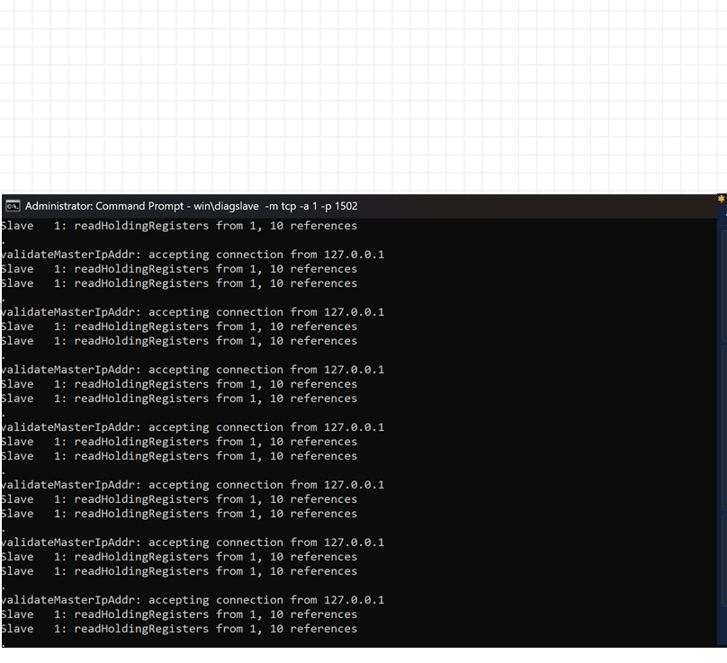
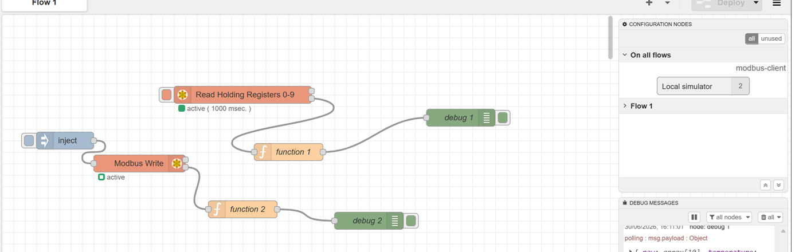

# 01 · Set-up and Tools

[← Back to README](../README.md)

## Tools

| Tool | Role | Settings used |
|---|---|---|
| diagslave (proconX / FieldTalk) | Modbus TCP **slave** simulator | `-m tcp -a 1 -p 1502` (TCP mode, Unit ID 1, port 1502) |
| Node-RED on the laptop (`localhost:1880`) | Modbus **master** under test | Palette `node-red-contrib-modbus` |
| Independent Modbus client ("Modbus Poll") | Second master for cross-checking | TCP/IP, 127.0.0.1:1502, timeout 2,000 ms, Slave ID 1, FC03, start 0, quantity 10, poll 1,000 ms |

## diagslave

```
diagslave -m tcp -a 1 -p 1502
```

| Switch | Meaning |
|---|---|
| `-m tcp` | Modbus TCP mode |
| `-a 1` | Slave address (Unit ID) 1 |
| `-p 1502` | Listen on port 1502. Port 502 is the standard port but is privileged; 1502 avoids admin and port-conflict problems on a dev machine |

When a master connects and reads, the console shows:

```
validateMasterIpAddr: accepting connection from 127.0.0.1
Slave   1: readHoldingRegisters from 1, 10 references
```

Note the **"from 1"**. diagslave reports 1-based register numbers, while the masters send address 0. See [docs/02](02-register-map-and-scaling.md#addressing-one-register-three-names).

<p align="center"></p>

## Node-RED flow

Built on one tab ("Flow 1") using a single shared `modbus-client` config node called **Local simulator** (127.0.0.1:1502, Unit ID 1), used by both Modbus nodes.

| Path | Nodes | Behaviour |
|---|---|---|
| Polled read | `modbus-read` **"Read Holding Registers 0-9"** → `function 1` → `debug 1` | Polls FC03, registers 0-9, every 1,000 ms by itself; no inject needed |
| On-demand write | `inject` → `modbus-write` **"Modbus Write"** → `function 2` → `debug 2` | Writes when the inject fires |

`function 1`, the scaling function:

```javascript
// raw = array of 10 holding registers (0-9)
const raw = msg.payload;
msg.payload = {
  raw: raw,
  temperature: raw[0] / 10,   // R0, ÷10 → °C
  voltage:     raw[1] / 10,   // R1, ÷10 → V
  sensor3:     raw[2],        // R2, unscaled
  timestamp:   new Date().toISOString()
};
return msg;
```

Captured output in `debug 1`:

```
{ raw: array[10], temperature: 50, voltage: 140.5, sensor3: 225, timestamp: "2026-06-30T15:11:02.617Z" }
```

<p align="center"></p>

## Order of start-up that works

1. Start diagslave.
2. Deploy the Node-RED flow. The `modbus-read` node shows **active (1000 msec.)**.
3. Connect the independent client to the same IP, port and Unit ID.
4. Watch all three: the diagslave console, the Node-RED debug sidebar and the client's register table.
